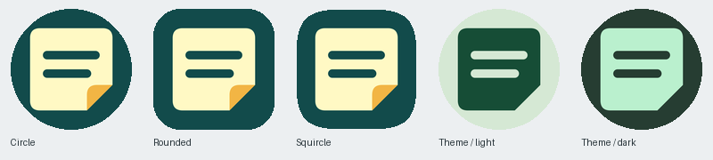

# MemoEZ アプリアイコン



深いティール（`#124B4B`）の背景に、淡い付箋（`#FFF9C4`）とアンバー（`#F2B544`）の折り返しを配置する。文字・グラデーション・影を使わず、2 本のメモ線で小サイズでも識別しやすくした。旧 EasyMEMO の文字入りノートとは異なる意匠。

## ソースと再生成

編集元は [`assets/icon.svg`](../assets/icon.svg)。画像生成で検討した付箋の案を、パスだけの編集可能な SVG として構成した。`background`、`note`、`fold` の各要素を編集できる。

Python 3 と CairoSVG 2.8.2（システムに Cairo ライブラリが必要）を使う。Debian/Ubuntu では必要に応じて `libcairo2` を導入する。生成用 venv はリポジトリの外に置く。

```sh
python3 -m venv /tmp/memoez-icons
/tmp/memoez-icons/bin/pip install CairoSVG==2.8.2
/tmp/memoez-icons/bin/python scripts/generate-icons.py
```

| 生成物 | 用途 |
| --- | --- |
| `assets/icon.png` | 1024×1024、不透明な通常アイコン。マークを 1.33 倍に拡大 |
| `assets/adaptive-icon.png` | 1024×1024、透明背景の Adaptive Icon 前景 |
| `assets/monochrome-icon.png` | 同じアルファ形状の白いマーク。Android 13+ がテーマ色に着色 |
| `docs/app-icon-preview.png` | 円・角丸・スクワークル・テーマ色の確認用。端末スクリーンショットではない |

前景は Android の 108 dp レイヤー内の中央 66 dp セーフサークルに収める。生成スクリプトは全不透明ピクセルのセーフサークル内配置とモノクロ版のアルファ一致も検証する。プレビューはランチャーの 72/108 ビューポートを模したもの。

`app.json` の `expo.icon` と `android.adaptiveIcon` から Expo SDK 52 が通常・丸型・前景・モノクロの mipmap を生成する。背景は `backgroundColor` で指定するため、背景用 PNG は不要。SVG の背景色を変更する際は `app.json` の `android.adaptiveIcon.backgroundColor` も同じ値に更新する。Expo SDK 52 は Android 7 以前用のフォールバックにも Adaptive 前景と背景を合成するため、通常 PNG よりマークの余白が広くなる。

```sh
npx expo prebuild --platform android --clean --no-install
```

`--clean` は生成済み `android/` を削除するため、ローカル変更を事前に確認する。Android ビルド時の Kotlin 設定は既存の `.github/workflows/android-build.yml` に従う。アプリ ID・バージョン・署名・更新方式は変更しない。

## 既存表示との整合性

- 2×2 ウィジェットのプレビュー色 `#FFF9C4` と付箋色を揃えた。4×2 の明るい一覧プレビューとも判別できる。ウィジェットはアプリのアイコンを継承し、専用アイコンの上書きはない。ウィジェットのレイアウト・動作は変更していない。
- 現在のリマインダーは in-memory 実装で、OS 通知用の small icon は未使用。通知機能を将来実装する際は専用の透過白アイコンを設定すること。カラーの launcher icon を流用しない。
- `assets/splash.png` は白いスプラッシュ用背景であり、旧アイコン画像を含まないため変更しない。
- 参照先 `YanTKYS/memonow` の assets はこの環境では 404 で取得できず、実物との並列比較は未実施。

## 端末での確認（未実施）

実機・エミュレーターは接続されていない。以下は APK インストール後に確認する。

- ホーム／アプリ一覧／ウィジェット選択画面のアプリアイコンが新意匠になること（ランチャーのキャッシュにも注意）。
- 円・角丸・スクワークル、明暗の壁紙で欠けや不自然な余白がないこと。
- Android 13 以降の「テーマアイコン」有効時にメモ線と折り返しの輪郭が判別できること。
- 既存 2×2／4×2 ウィジェットの表示と操作に差がないこと。

## 今回の検証結果

- SVG からの再生成、全画像の SHA-256 一致、セーフサークルとアルファ一致を確認。
- TypeScript、Lint、Jest（25 スイート・126 テスト）が成功。
- 最終画像からの `expo prebuild --platform android --clean --no-install --skip-dependency-update react,react-native`、既存 CI の Kotlin 設定で `assembleDebug` が成功。
- APK 内の全 20 個の launcher WebP が prebuild 出力とバイト単位で一致。通常／丸型 XML の foreground・background・monochrome、`com.memoez.app`、既存ウィジェット 2 種のクラス・manifest と Google Sign-In の同梱も確認。
- 端末の画面・テーマ色・ウィジェット操作は上記チェック項目のとおり未確認。
